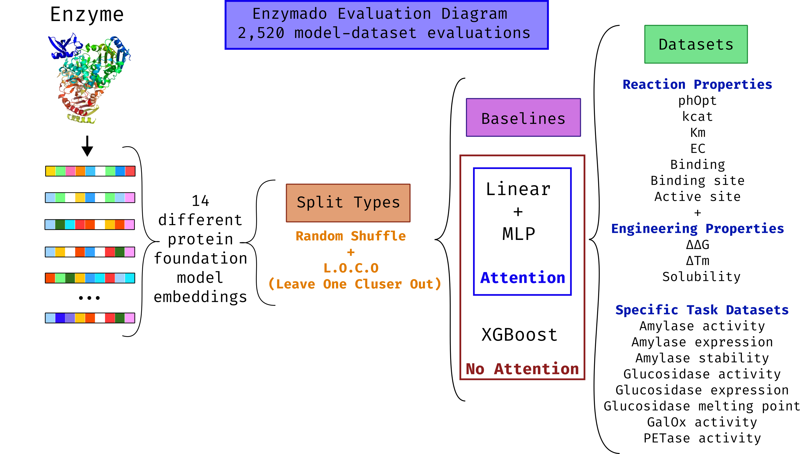

# Enzymado

**A reproducible benchmark for protein language model embeddings on enzyme property prediction.**

Enzymado asks a narrow, practical question: *if you take a frozen protein language model
and train a simple head on top of its embeddings, how well does that work for real enzyme
engineering tasks?* It answers it the same way for every model, on every dataset, with
every split, so the numbers are comparable.

<p align="center">
  
</p>

---

## What it evaluates

| axis | values |
|---|---|
| **Property datasets** | 10 — `binding`, `binding_site`, `active_sites`, `ec_number`, `solubility`, `kcat`, `km`, `ph_opt`, `dtm`, `ddg` |
| **Real-case datasets** | 8 — amylase (activity / expression / stability), glucosidase (activity / expression / melting), GalOx, PETase |
| **Protein language models** | 14 — ESM-2 (650M, 3B), ESM-3, ESM-C (300M, 600M), Ankh (base, large), Ankh3 (large, XL), ProtT5, ProstT5, ProFluent-E1 (300M, 600M) |
| **Split types** | 2 — `random` and `similarity` (MMseqs2 clustering, so test proteins are not near-duplicates of training ones) |
| **Baselines** | 5 — linear, MLP and XGBoost over mean-pooled embeddings, plus linear and MLP over learned attention pooling |

That grid is **1,960 model–dataset evaluations**: 1,400 on properties (10 × 14 × 2 × 5)
and 560 on real cases (8 × 14 × 1 × 5).

Embeddings are **frozen**. Nothing fine-tunes the language model — the benchmark measures
what the representation already carries, not what a full fine-tune could extract.

---

## How a run works

The pipeline is a straight line, and each stage has one job:

```
data_loading  →  training  →  prediction  →  evaluation
```

1. **`data_loading`** turns a task name into a ready-to-train bundle: rows from the dataset
   CSV, embeddings pulled from safetensors shards, labels built per task type, and the
   split assignment. Residue-level tasks stream embeddings lazily so that a ~390 GB store
   never has to fit in RAM.
2. **`training`** takes that bundle plus an architecture from `models`, runs the training
   loop with early stopping on validation loss, and returns a fitted estimator.
3. **`prediction`** takes what training produced and writes predictions for each split as
   compressed safetensors, alongside the model weights and a run manifest.
4. **`evaluation`** reads those prediction artifacts and produces metrics, bootstrap
   confidence intervals, and finally the global leaderboards.

Two supporting packages sit underneath: **`models`** holds only architectures, and
**`artifacts`** owns the result-tree layout, serialization, and provenance. Dependencies
run one way — `evaluation` never imports `training`.

### Metrics

| task type | metrics |
|---|---|
| classification | `accuracy`, `precision`, `recall`, `f1`, `auroc`, `auprc` |
| regression | `mae`, `rmse`, `r2`, `kendall_tau` |

Classification metrics are computed from per-row sufficient statistics — confusion counts
for the threshold metrics, score histograms for AUROC and AUPRC. That keeps each of the
1,000 bootstrap replicates an O(1) aggregation instead of a full recomputation, which is
what makes interval estimation tractable on tasks with 10⁸ predictions.

### Ratings

Per-task metrics become two global leaderboards (`properties` and `real_case`) via
**Bradley–Terry maximum likelihood** over pairwise outcomes, anchored at 1500. Defaults:
1,000 battle rounds, Kendall tau weighted double among regression metrics, and property
splits weighted 55% similarity / 45% random.

---

## Quickstart

Requires Python ≥3.12,<3.14 and [uv](https://docs.astral.sh/uv/).

```bash
uv sync --extra train
```

Train and predict one combination:

```bash
python scripts/run_benchmark.py embeddings_models_output.json \
  --output_dir results/predictions \
  --emb_name ankh_base \
  --task_name ph_opt \
  --model_prefix mlp_ \
  --split_variant random
```

Then evaluate:

```bash
python scripts/results/compute_metrics.py            --filter-task ph_opt
python scripts/results/compute_bootstrap_metrics.py  --filter-task ph_opt --n-replicates 1000
python scripts/results/compute_ratings.py
```

On a Slurm cluster, `scripts/slurm/` wraps the same entry points as array jobs over the
14 embedding models. See [PIPELINES.md](PIPELINES.md) for the full CLI surface.

---

## Extending it

**Add a dataset.** Register it in `benchmark_card.json` with its task type and paths, then
add a `TaskConfig` in `src/enzymado/data_loading/data_registry.py` describing its columns,
label kind, and batch kind. Nothing else needs to change: splits, training, prediction, and
evaluation all dispatch on that config.

**Add a model.** Implement the estimator in `src/enzymado/training/`, exposing `fit` /
`predict` (or `fit_loader` / `predict_loader` for residue-level tasks), and register it in
`model_registry.py` with its hyperparameters.

**Add a metric.** Declare it in `src/enzymado/evaluation/metrics_registry.py` with its task
type and direction. Classification metrics must be derivable from confusion counts or score
histograms so the bootstrap stays fast.

---

## Results layout

```
results/
  predictions/       per-run artifacts: predictions, weights, hparams.json, metrics.json
  bootstrap/         resampled metric distributions
  ratings/           the two global leaderboards
  figures/           dataset cards, cluster diversity, UMAP projections
```

Every run directory carries a `run_manifest.json` fingerprinting its dataset, embeddings,
hyperparameters, and source tree, so a published number can be traced back to the exact
inputs that produced it.

---

## License

MIT — see [LICENSE](LICENSE).
