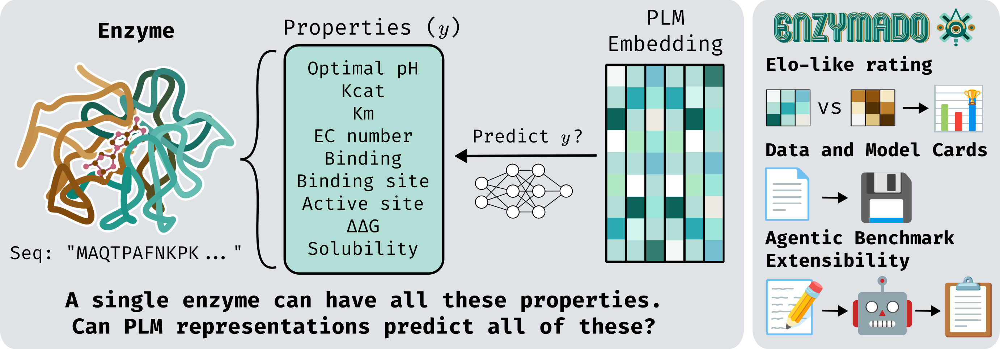

<h1 align="center">
  
</h1>

**An enzyme benchmark for protein representations.**

Enzymado asks a narrow, practical question: *if you take a frozen protein language model
and train a simple head on top of its embeddings, how well does that work for enzyme
tasks?* It answers it the same way for every model, on every dataset, with every split, so
the numbers are comparable.

<p align="center">
  
</p>

<p align="center">
  <b><a href="https://huggingface.co/spaces/Enzymado/Enzymado">Explore the results in the browser</a></b>:
  leaderboards, per-dataset comparisons, label distributions and UMAP projections,
  recomputed from the published numbers in this repository.
</p>

---

## What it evaluates

| axis | values |
|---|---|
| **Property datasets** | 10: `binding`, `binding_site`, `active_sites`, `ec_number`, `solubility`, `kcat`, `km`, `ph_opt`, `dtm`, `ddg` |
| **Case studies** | 8: amylase (activity / expression / stability), glucosidase (activity / expression / melting), GalOx, PETase. All regression. Paths, flags and keys call this scope `real_case`. |
| **Protein language models** | 14, see the table below, plus `noplm`, a reference built without a language model |
| **Split types** | 2: `random` and `similarity` (MMseqs2 at 30% identity and 80% coverage, whole clusters assigned to one split, 80/10/10). Case studies are `random` only. |
| **Baselines** | 5: linear, MLP and XGBoost on mean-pooled embeddings, plus linear and MLP over learned attention pooling. Protein-level tasks pool the embedding; residue-level tasks (`active_sites`, `binding_site`) keep one embedding per residue. |

The 14 embedding models, with the manifest key each one is addressed by:

| family | manifest key | dim |
|---|---|---|
| ESM-2 | `esm2_650M`, `esm2_3B` | 1280, 2560 |
| ESM-3 | `esm3_open` | 1536 |
| ESM-C | `esmc_300m`, `esmc_600m` | 960, 1152 |
| Ankh | `ankh_base`, `ankh_large` | 768, 1536 |
| Ankh3 | `ankh3_large`, `ankh3_xl` | 1536, 2560 |
| ProtT5 | `prot5_xl_uniref50`, `prot5_xl_half_uniref50` | 1024, 1024 |
| ProstT5 | `prost5` | 1024 |
| ProFluent-E1 | `profluent_e1_300m`, `profluent_e1_600m` | 1024, 1280 |

`noplm` holds 36 ProtParam descriptors (amino acid composition, secondary structure
fractions, molecular weight, isoelectric point, GRAVY, instability index, aromaticity,
extinction coefficients, net charge at pH 7.4 and five statistics of the flexibility
profile) as its pooled vector and a one-hot encoding of the 20 amino acids per residue
(`scripts/embeddings/build_noplm_features.py`). It runs through the same five baselines and
competes in both leaderboards, so every PLM is compared with what needs no language model.

That grid is **1,960 PLM runs** (1,400 on properties, 10 × 14 × 2 × 5, and 560 on real
cases, 8 × 14 × 1 × 5) plus **140 `noplm` runs**.

Embeddings are **frozen**. Nothing fine-tunes the language model: the benchmark measures
what the representation already carries, not what a full fine-tune could extract.

Every model competes on the **same proteins**. The embedding stores do not cover the
sequence index identically, so `scripts/embeddings/build_embedding_intersection.py`
computes their intersection once and every run is restricted to it via `--allowed_ids`.
The published runs use **269,409 shared sequence IDs**: of the 270,029 sequences in
`data/processed/protein_pool.csv`, the 620 left out are 2,645 residues or longer
and ran out of GPU memory in ESM3. (`excluded_ids.txt` also lists IDs of an earlier, larger index
that no dataset uses any more.) `results/embedding_intersection/report.tsv` records the
per-model coverage.

Every published run uses **training seed 42**. Seeds 43 and 44 retrain a subset of the runs
to measure training noise (see [Ratings](#ratings)).

---

## Datasets

Every source is converted to one table format, deduplicated into the shared sequence index,
split once, and released with its split assignment as a column of the CSV. Regression
targets are standardized on the training split. Two dataset-level decisions matter when
reading the results:

- **UniProt fragments are removed** from the tasks whose label describes the whole protein
  (`binding`, `ec_number`, `kcat`, `km`, `ph_opt`, `solubility`) by
  `scripts/data_prep/remove_uniprot_fragments.py`, after the splits are made: rows keep
  their split and regression targets are standardized again on the remaining train rows.
  The fragment list and its UniProt release are in `data/processed/uniprot_fragments.{csv,json}`.
  Residue tasks keep fragments: their labels are positions on the deposited sequence and all
  fall inside it.
- **Case-study targets that span two or more orders of magnitude are modeled as log10**
  (GalOx and PETase activity, amylase activity and stability, glucosidase activity and
  expression), with zeros offset by the smallest positive value at one significant figure
  (`scripts/data_prep/clean_real.py`). PETase rows also carry the reaction temperature, pH
  and buffer as numeric features.

Similarity splits use MMseqs2 at a minimum identity of 0.3. The 0.5 threshold recorded in
the dataset cards belongs to a separate whole-dataset diversity analysis and does not define
the splits. `fluorescence` was dropped from the benchmark because it does not contain
enzymes.

---

## How a run works

The pipeline is a straight line, and each stage has one job:

```
data_loading  →  training  →  prediction  →  evaluation
```

1. **`data_loading`** turns a task name into a ready-to-train bundle: rows from the dataset
   CSV, embeddings pulled from safetensors shards, labels built per task type, and the
   split assignment. Residue-level tasks stream embeddings lazily so that a 4.6 TB store
   never has to fit in RAM.
2. **`training`** takes that bundle plus an architecture from `models`, trains it with early
   stopping on the validation split, and returns a fitted estimator.
3. **`prediction`** writes predictions for each split as compressed safetensors, alongside
   the model weights and the run's hyperparameters.
4. **`evaluation`** reads those prediction artifacts and produces metrics, bootstrap
   confidence intervals, training-noise margins and the global leaderboards.

`pipeline` is the orchestration layer that resolves a CLI selection into concrete runs and
drives those four stages. Two packages sit underneath them: **`models`** holds only
architectures, and **`artifacts`** owns the result-tree layout, serialization, and
provenance. Dependencies run one way: `evaluation` never imports `training`.

Three more packages build the inputs rather than consume them, and run only when datasets
are regenerated: **`propertyprep`** (source-specific ingestion for BRENDA, BioLiP,
SwissProt, FireProtDB, CatPred, Proteinea and UniProt), **`splitting`** (random and MMseqs2
similarity splits, plus their metadata), and **`dataset_card`** (per-dataset statistics,
clustering, and UMAP figures).

### Training routes

A task's `batch_kind` and `label_kind` in `src/enzymado/data_loading/data_registry.py`
choose its route; `src/enzymado/training/model_registry.py` maps each model name to its
wrapper.

| route | tasks | input |
|---|---|---|
| `protein_global` + `binary` / `scalar_regression` | `solubility`, `ph_opt`, case studies | pooled protein vector |
| `protein_global` + `multilabel_ec` | `ec_number` | pooled vector; hierarchical multi-head classifier, or one flat concatenated target for XGBoost with unknown descendants masked per column |
| `protein_ligand_global` | `binding`, `kcat`, `km`, `cleeveland_galox` | pooled vector joined with the 200 descriptastorus `RDKit2DNormalized` descriptors of the substrate (`data/ligand_features/descriptastorus.npz`, not tracked: build it once with `scripts/data_prep/build_ligand_features.py`) |
| `mutation_delta_global` | `ddg`, `dtm` | mutant minus wild-type embedding |
| `protein_residue` + `residue_binary_vector` | `active_sites`, `binding_site` | one embedding per residue, through `DataLoader` batches |

Global attention pooling (`ResidualAttentionAggregation`) adds a learned attention update to
the mean of the residues: the mean of the layer-normalized residues queries the residues,
and the result is added back to the mean, so a silent attention branch returns mean pooling
exactly. Residue tasks use `AttentionResidueMixer`, the same block with every residue as a
query and nothing pooled. Attention heads train like their mean-pool counterparts (same
optimizer, learning rate, weight decay, dropout and early stopping, gradients accumulated to
a batch of 256).

The linear head is the MLP wrapper with no hidden layer, trained in minibatches of 256 like
the MLP. The MLP has one hidden layer of 2,048 units (256 on residue tasks), chosen once by a
400-sample Latin hypercube search on `km` and reused everywhere.

### Checkpoint selection

Neural heads are scored on the validation split after every epoch and the best epoch is
restored; epoch 0 is kept as `initial_model.pt` only as a reference. Pooled tasks select on
Kendall's tau (regression) and AUPRC (classification). EC heads select on validation AUPRC
pooled over the four EC levels, accumulated batch by batch in a score histogram
(`StreamingAUPRC`), the same estimator the leaderboard uses, so memory does not grow with
the validation matrix. The residue tasks select on validation loss. XGBoost stops early on
AUPRC, RMSE, or log loss (EC and residue tasks).

Non-finite losses, gradients, weights and monitored predictions fail the run. Constant
predictions leave Kendall's tau undefined and make an epoch ineligible; in evaluation, a
fully tied prediction scores tau = 0. A checkpoint resumes only in an identical environment:
the run manifest hashes the dataset, the embedding store, the source tree and the lockfile.

### Metrics

| task type | metrics |
|---|---|
| classification | `accuracy`, `precision`, `recall`, `f1`, `auroc`, `auprc` |
| regression | `mae`, `rmse`, `r2`, `kendall_tau` |

Classification metrics are computed from per-row sufficient statistics: confusion counts for
the threshold metrics and score histograms for AUROC and AUPRC (`ranking_source` records
which). That keeps each of the 1,000 bootstrap replicates an O(1) aggregation instead of a
full recomputation, which makes intervals tractable on tasks with 10⁸ predictions:
`ec_number` alone scores 1.36 × 10⁸ test predictions. Bootstrap units are proteins for EC
and residue tasks and rows otherwise; every model of a task and split is scored on the same
resamples, after their ordered test sample identities are checked.

### Ratings

Per-task results become two global leaderboards (`properties` and the case studies, `real_case`) via
weighted **Bradley–Terry maximum likelihood** over paired bootstrap battles, centered at
1500. In each of 1,000 bootstrap rounds every pair of the 75 competitors (15 embeddings × 5
baselines) plays one battle per rated metric on every task and split; refits per round give
the intervals.

Everything that shapes the ratings lives in the **`rating` section of
`benchmark_card.json`**, which `compute_ratings.py` reads and each leaderboard JSON records:

- **Rated metrics.** Regression: Kendall's tau (0.75) and MAE (0.25). Classification:
  AUROC, AUPRC, F1, precision and recall (0.2 each). `rmse`, `r2` and `accuracy` are
  reported but not rated: within a replicate `rmse` orders models exactly as `r2` does and
  MAE already scores the error size, and accuracy is uninformative on rare labels.
- **Task weights.** Property tasks are weighted by how directly they test knowledge of
  enzymes, in five equal steps: `ec_number`, `active_sites` 1.0; `kcat`, `binding_site`
  0.8; `km`, `ph_opt` 0.6; `ddg`, `dtm` 0.4; `binding`, `solubility` 0.2. The case
  studies weigh equally.
- **Split weights.** Each property task weight is split 0.4 random / 0.6 similarity.
- **Training-noise ties.** A battle is a tie, half a win each, when the gap is within
  `z * sqrt(sigma_a^2 + sigma_b^2)` with z = 1.96, sigma being the training-noise SD of each
  competitor's head and pooling on that task, split and metric
  (`results/noise_seeds/tie_margins_v4.csv`). `scripts/results/compute_tie_margins.py`
  derives it from seeds 42-44: the median over PLMs of each PLM's seed SD, divided by
  `c_n = sqrt(median(chi2_{n-1}) / (n - 1))` so it estimates sigma under normal noise.
  Regression runs with a training R² below -1 are left out of sigma (not of the
  leaderboard).
- **Exclusions.** A Kendall's tau or AUROC cell is withheld when even the best competitor
  stays below the no-skill references 0.1 / 0.55; no cell met that rule in the published
  results. The property leaderboard rates 70 metric cells and the case-study one 16.

Command-line flags of `compute_ratings.py` (`--tie-z`, `--tie-margins`,
`--random-weight`, `--similarity-weight`) override the card for sensitivity analyses; for
example `--tie-z 0` gives the strict comparison.

---

## Quickstart

Requires Python ≥3.12,<3.14, [uv](https://docs.astral.sh/uv/), and **Git LFS**. The
datasets under `data/` and the JSON results are LFS objects: without `git lfs install`
before cloning, they arrive as pointer files and every run fails on unreadable inputs.

```bash
git lfs install
git clone <repo-url> && cd enzymado-benchmark
uv sync --extra train
```

### Reproduce the leaderboards

[REPRODUCE.md](REPRODUCE.md) walks through three levels of reproduction, from these
commands to retraining one task or the whole grid.

The tracked results are enough to recompute both leaderboards on a CPU in a few minutes:

```bash
python scripts/results/compute_tie_margins.py   # seeds 42-44 metrics -> results/noise_seeds/tie_margins_v4.csv
python scripts/results/compute_ratings.py       # results/bootstrap + card -> results/ratings/seed_42_two_leaderboards/
```

Both rewrite their outputs in place; `git diff` shows that nothing changed.

### Train and evaluate

Training reads embeddings through a manifest of local paths, which is machine-specific and
therefore not tracked. Copy the template and point it at your own embedding store:

```bash
cp embeddings_models_output.example.json embeddings_models_output.json
cp embeddings_models_output_mean_pooled.example.json embeddings_models_output_mean_pooled.json
# then edit the "path" of each model
```

`embeddings_models_output.json` lists per-residue shard directories;
`embeddings_models_output_mean_pooled.json` lists single mean-pooled files. Pooled tasks work
from either manifest (a residue store is mean-pooled on the fly), but the pooled manifest is
much faster, and residue-level tasks and attention baselines require the residue one.

Train and predict one combination:

```bash
python scripts/run_benchmark.py embeddings_models_output_mean_pooled.json \
  --output_dir results/predictions \
  --emb_name ankh_base \
  --task_name ph_opt \
  --model_prefix mlp_ \
  --split_variant random \
  --allowed_ids results/embedding_intersection/common_ids.txt
```

Useful filters: `--emb_name` (one embedding), `--model_prefix` (`linear_`, `mlp_`, `xgb_`,
`attention_linear_`, `attention_mlp_`), `--task_name` (repeatable), `--task_scope`
(`properties` by default; `real_case` must be requested), `--split_variant` (`random` by
default), `--embedding_mode` (`attention` / `no_attention`), `--attention_embeddings_json`
(the per-residue manifest; attention models do not train without it), `--residue_store_mode`
(`materialized` / `lazy`), `--overwrite_results` and `--deterministic`.
`python scripts/run_benchmark.py --help` lists the rest.

```bash
python scripts/run_benchmark.py embeddings_models_output_mean_pooled.json \
  --task_scope real_case --task_name erickson_petase --model_prefix linear_
python scripts/run_benchmark.py embeddings_models_output_mean_pooled.json \
  --attention_embeddings_json embeddings_models_output.json \
  --embedding_mode attention --task_name ph_opt --model_prefix attention_mlp_
```

Then evaluate:

```bash
python scripts/results/compute_metrics.py            --filter-task ph_opt
python scripts/results/compute_bootstrap_metrics.py  --filter-task ph_opt --n-replicates 1000
python scripts/results/compute_tie_margins.py
python scripts/results/compute_ratings.py
```

The two scoring scripts do different jobs:

- `compute_bootstrap_metrics.py` gives the leaderboard its scores, and it needs nothing run
  before it. For each run it recomputes the test metrics, resamples the test set and writes
  the replicates to `results/bootstrap/.../test.npz`, which `compute_ratings.py` reads. It
  also writes the test point estimates and their intervals into the run's `metrics.json`
  (`test` and `test_bootstrap`), keeping any `train` and `val` blocks already there. It does
  not compute train or val. The `--n-replicates` default is 200; the published results use
  1,000.
- `compute_metrics.py` computes point estimates for every split (train, val and test) into
  `metrics.json`, without resampling. Use it to look at a model's numbers on any split, and
  before `compute_tie_margins.py`: the tie margins read the test metrics of the seed
  retrainings, which have no bootstrap, and drop regression runs whose train R2 is below
  -1, a train block only `compute_metrics.py` writes. Without it that filter keeps every
  run.

The leaderboard needs both the bootstrap and a tie margin (sigma) for every cell:
`compute_ratings.py` reads sigma from the file named in `benchmark_card.json`
(`results/noise_seeds/tie_margins_v4.csv`) and stops if a cell has none. To rate again a
task already in that file, the bootstrap is all you need. A new task first needs its seed
retrainings, `compute_metrics.py` on every seed (42 included) and `compute_tie_margins.py`.

`compute_metrics.py` rewrites the whole `metrics.json`, so running it after the bootstrap
erases the `test_bootstrap` block (the `test.npz` replicates and the leaderboard are not
affected). When you need both, run `compute_metrics.py` first. For classification, both
scripts share a per-row count cache under `results/evaluation_statistics/` (untracked,
keyed by the SHA-256 of each prediction file), which either one builds when it is missing.

On a Slurm cluster, `scripts/slurm/` wraps the same entry points as array jobs over the 14
embedding models; pass your own `--account`.

### Computing the embeddings

The embedding stores are not distributed: they are about 4.6 TB at residue level. To rebuild
them:

```bash
python scripts/data_prep/concat_unique_protein_sequences.py   # canonical sequence index
python scripts/data_prep/make_fasta_from_unique_sequences.py  # deduplicated FASTA
```

then run the per-family scripts in `embedding_scripts/` (`ankh`, `esm2`, `esm3`, `esmc`,
`profluent`, `prost5`, `prot5`), each of which takes `-i <fasta> -o <shard dir> --model
<key>` and can also emit the mean-pooled file via `--mean_pooled_output`. These models have
mutually incompatible dependencies, so each family needs its own environment; `envs_files/`
holds the conda YAMLs and pinned requirement files used for the published run. The
`noplm` reference is built with `scripts/embeddings/build_noplm_features.py`. Finally,
rebuild the shared ID set:

```bash
python scripts/embeddings/build_embedding_intersection.py --embeddings-json embeddings_models_output_mean_pooled.json
```

### Tests

```bash
uv run pytest
```

`tests/` covers the registries, the data-loading and training routes, artifact
serialization, reproducibility contracts, the rating configuration in the benchmark card,
and the evaluation and ranking statistics.

---

## Extending it

**Add a dataset.** [add_data.md](add_data.md) goes step by step from a CSV to scored
runs. A `TaskConfig` in `src/enzymado/data_loading/data_registry.py` describes its
columns, label kind and batch kind, and splits, training, prediction and evaluation all
dispatch on it. A dataset that joins the leaderboards also needs an entry in
`benchmark_card.json`, a weight in the card's `rating.task_weights` if it is a property
task, and results for all 75 competitors; `scripts/ci/check_registry_card_parity.py`
checks that the registry and the card stay in sync.

**Add a model.** Implement the estimator in `src/enzymado/training/`, exposing `fit` /
`predict` (or `fit_loader` / `predict_loader` for residue-level tasks), and register it in
`model_registry.py` with its hyperparameters.

**Add an embedding.** Embed the shared sequence index, add the model to the manifests, train
the five baselines, add the key to `_foundation_models()` in
`scripts/results/compute_ratings.py`, and recompute metrics, bootstrap and ratings. The
existing runs stay valid.

**Add a metric.** Declare it in `src/enzymado/evaluation/metrics_registry.py` with its task
type and direction, and give it a weight in the card's `rating.metric_weights` if it should
cast battles. Classification metrics must be derivable from confusion counts or score
histograms so the bootstrap stays fast.

---

## Results layout

```
results/
  predictions/            per-run artifacts; metrics.json and hparams.json are published
  bootstrap/              1,000-replicate metric distributions per run
  ratings/                the two global leaderboards and their per-round ratings
  noise_seeds/            tie_margins_v4.csv and the test metrics of seeds 43 and 44
  embedding_intersection/ the shared sequence-ID set every run is restricted to
  figures/                cluster diversity figures
```

Runs are addressed by
`<scope>/<pool_type>/<split>/<model_family>/<task>/<embedding_model>/`, and each run
directory carries a `hparams.json` fingerprinting its dataset paths, task config,
hyperparameters and seed, so a published number can be traced back to the exact inputs that
produced it.

Only the numbers are published. Prediction tensors, model weights and per-epoch logs stay
local: they are gigabytes of LFS, and every figure and leaderboard is recomputable from the
tracked `metrics.json`, `hparams.json` and bootstrap distributions. Per-dataset cards live
next to the data, at `data/processed/properties/<task>/dataset_card.json`.

---

## Citing Enzymado

The paper is in preparation. Until it appears, cite the software:

```bibtex
@software{enzymado,
  title    = {Enzymado: Holistic Benchmark for Enzyme Representations},
  author   = {Barraza-Chavez, Jose Manuel and Almada-Monter, Ricardo and
              Chau, William and Barghout, Rana A. and Abdur Rakib, Aziz and
              Kirby, Maxim and Mahadevan, Radhakrishnan and Jinich, Adrian and
              Sanchez-Lengeling, Benjamin},
  year     = {2026},
  version  = {0.0.1},
  url      = {https://github.com/chemcognition-lab/enzymado-benchmark},
  note     = {Interactive results: https://huggingface.co/spaces/Enzymado/Enzymado}
}
```

Please also cite the datasets you use: each one's source is recorded in its dataset card
(`data/processed/<scope>/<task>/dataset_card.json`) and in the [Datasets](#datasets)
section above.

## Contact

Questions, bug reports and dataset proposals belong in
[GitHub Issues](https://github.com/chemcognition-lab/enzymado-benchmark/issues), so the
answers stay findable. For anything else, write to Jose Manuel Barraza-Chavez
(<jose.barrazachavez@mail.utoronto.ca>). The benchmark is developed by
[chemcognition-lab](https://github.com/chemcognition-lab).

---

## License

MIT, see [LICENSE](LICENSE).
